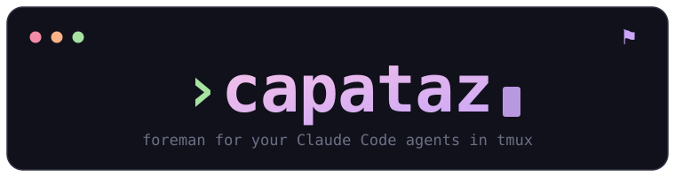
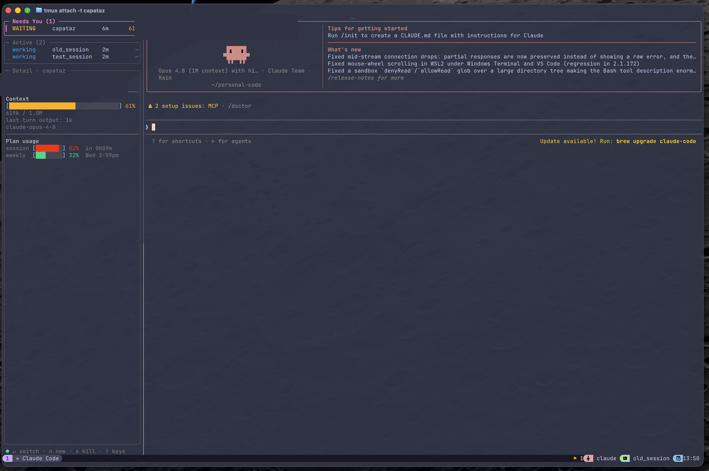
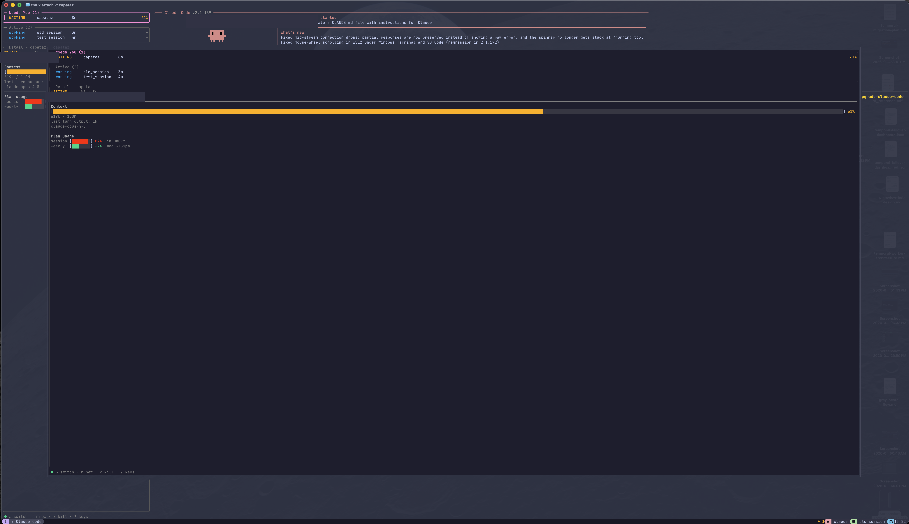

<p align="center">
  
</p>

<p align="center">
  A terminal dashboard that supervises your <a href="https://claude.com/claude-code">Claude&nbsp;Code</a> agents in tmux.<br>
  It surfaces which agent needs your attention and puts you there in one keystroke.
</p>

<p align="center">
  
</p>

## Why

When you run several Claude Code agents at once, it's hard to tell which one is blocked on you. `capataz` watches them all through Claude Code's hooks and gives you one place to see status and jump in — either as a quick **popup switcher** or a persistent **sidebar** docked next to whatever you're working on.

## Requirements

- **macOS** (uses the macOS Keychain and `launchd`)
- **tmux** — agents run in tmux panes; the dashboard drives them via tmux
- **Claude Code** — `capataz` wires into its hooks
- **Go 1.26+** — to build

## Install

```sh
git clone https://github.com/bmena34/capataz && cd capataz
make install        # builds and copies to /usr/local/bin (prompts for sudo password)
capataz install     # wire Claude Code hooks + start the daemon
```

`capataz install` merges hooks into `~/.claude/settings.json` (backing up the original), installs a `launchd` agent for the background daemon, installs the `capataz-work` skill into `~/.claude/skills`, and writes a default config. **Hooks load when a Claude session starts**, so restart any sessions you already have running.

Then bind the tmux keys (live + prints lines for your `~/.tmux.conf`):

```sh
capataz keybind          # prefix+g — summon the dashboard popup
capataz keybind attach   # prefix+a — dock a dashboard sidebar in the current window
capataz keybind nav      # Ctrl+h/j/k/l — move between panes (nvim-aware)
capataz statusline       # optional: show a "needs you" badge in your tmux status bar
```

## Usage

- **`prefix + g`** — open the dashboard as a floating popup (a switcher). Pick a session with `Enter` and it switches you there.
- **`prefix + a`** — dock the dashboard as a sidebar in the current window. `Ctrl+h`/`Ctrl+l` move between the sidebar and your work.
- **`n`** — spawn a new Claude session (prompts for directory, then name); it comes up with its own sidebar.

<p align="center">
  
  <br><sub>the popup switcher (<code>prefix + g</code>)</sub>
</p>

Keys inside the dashboard:

| Key | Action |
|-----|--------|
| `j` / `k`, arrows | move selection |
| `gg` / `G` | top / bottom |
| `Ctrl+d` / `Ctrl+u` | half-page down / up |
| `Enter` / `o` | switch to the selected session (or resume it if it ended) |
| `n` | new session |
| `r` | quick reply without leaving the dashboard |
| `c` | conversation view |
| `d` | peek at the session detail without switching |
| `l` | event log |
| `R` | rename the session |
| `x` | quit the selected session (graceful, with confirm); on a resumable row — dismiss it |
| `i` | open the full-screen issue backlog for the selected repo |
| `?` | toggle keyboard shortcut help |
| `q` / `Esc` | close the dashboard |

Keys inside the **issue view** (`i`):

| Key | Action |
|-----|--------|
| `j` / `k`, arrows | move selection |
| `Enter` / `o` | start work on the selected issue |
| `space` | toggle multi-select |
| `p` | show confirm modal then drain the selected issues hands-off |
| `P` | skip confirm and drain the whole feature immediately |
| `w` | work exactly the selected issues (bounded drain, then stop) |
| `R` | fresh-context correctness review of the feature |
| `S` | fresh-context OWASP security review of the feature |
| `M` | pick a model override for the next dispatch |
| `m` | merge resolved dispatch branches back into the base |
| `x` | prune orphaned dispatch worktrees |
| `?` | shortcuts help |
| `q` / `Esc` | return to the session list |

**Quit behavior.** When you quit a session from the dashboard (`x` → confirm `y`), the row disappears immediately and the session is hard-deleted from the daemon — it will not reappear. The graceful `/quit` signal and window teardown happen in the background. If a session's process dies *without* an operator quit — tmux-server restart, reboot, crash — the daemon retains it as a **resumable** row. Press `Enter` on a resumable row to resume the session via `claude --resume` in the original working directory.

**After a reboot**, just run `capataz` from a plain terminal: when no tmux server is running it resumes your most recently active resumable session and attaches you to it, dropping you straight back into your work. The rest of your sessions wait in the sidebar's *Resumable* panel, one `Enter` away each. Set `"resume": { "auto_attach": false }` in the config to get the new-session prompt instead.

## First run

After installing, here is the end-to-end path for your first five minutes:

1. **Open a tmux session** (or use one you already have).
2. **Bind the keys** if you have not already:
   ```sh
   capataz keybind        # prefix+g → popup
   capataz keybind attach # prefix+a → sidebar
   capataz keybind nav    # Ctrl+h/j/k/l → move between panes
   ```
   Each command prints the lines to add to `~/.tmux.conf` for permanence, and applies them live immediately.
3. **Press `prefix+g`** inside tmux. The popup switcher opens. It will be empty — that is fine.
4. **Press `n`** inside the popup to spawn a new Claude Code session. Enter a directory (`~` or any project root) and a name, then hit `Enter`. A new tmux window opens with Claude Code and a sidebar docked to it.
5. **Interact with Claude** in that window. You will see its status update in the sidebar in real time: `working`, `waiting`, `needs you`.
6. **Switch back to the popup** (`prefix+g`) at any point. Your session appears in the list with its current status and last event. Press `Enter` to jump to it, `r` to quick-reply without leaving, or `i` to open its issue backlog.
7. **Quit a session** with `x` (confirm with `y`) from the dashboard. It disappears immediately. If tmux or your Mac reboots and Claude's process dies unexpectedly, the session reappears as a resumable row — press `Enter` on it to resume via `claude --resume`.

## How it works

- **Hooks** — Claude Code fires hooks (SessionStart, PreToolUse, Stop, Notification, SubagentStop, …) that run `capataz hook <kind>`, reporting each event (with its tmux pane) to the daemon.
- **Daemon** — a small `launchd`-managed background process keeps per-session state, prunes sessions whose tmux pane has died, and pushes live updates to every open dashboard over a Unix socket.
- **Dashboard** — a [Bubble Tea](https://github.com/charmbracelet/bubbletea) TUI. You can run several at once (one per sidebar plus a popup); they all read the same daemon state.

It tracks **only tmux sessions** — the ones it can actually act on. Task subagents share their parent's session, so the dashboard shows a `⊂N` count of running subagents on the parent row rather than separate entries.

## Issue tracking

`capataz` reads a per-repo backlog of markdown issues and lets you put an agent on one. The **sidebar** shows a concise status tracker — the backlog of the selected session's repo, one dot per issue, sorted attention-first (blocked / todo / doing / done) with a counts summary. To **act** on the backlog, open the **popup** (`prefix + g`) and press **`i`**: browse the issues and `Enter` on one to start work, either in a **new session** or by handing it to the session you have selected. Either way the receiving session acts as an **orchestrator** — it delegates the actual work to a **subagent** (shown as a `⊂N` count on its row) so its own main-thread context stays clean.

**The review loop.** Three optional review steps keep the work honest:

- **Per-issue sanity check** (opt-in via config `review.sanity_check`): before an agent resolves an issue, the `capataz-work` skill spawns a fresh-context subagent to check the change actually matches the issue's acceptance criteria — a guard against an agent fooling itself.
- **Fresh full review** (`R` in the issues view): when a feature's issues are all resolved, press `R` to spawn a **new session** that runs the `capataz-review` skill — a clean context with no memory of how the code was written, so it judges soundness rather than trusting the implementers. Its findings are filed straight back into the backlog as new `ready-for-agent` issues, so the loop continues (review → issues → fix → review) until a review comes back clean.
- **Fresh security review** (`S` in the issues view): press `S` to spawn a **new session** running the `capataz-security` skill — the same fresh-context discipline, but an **OWASP-lens** audit (injection, broken access control, secret handling, crypto, deserialization, …) of the change set. It files each real vulnerability as a severity-tagged (`[high]`, `[medium]`, …) `ready-for-agent` issue. Run it when a feature's surface warrants it — auth, input parsing, file/exec, network, or secrets.

> **⚠️ For parallelism, use `p` — don't hand-start overlapping agents.** A single-issue dispatch (`Enter`) and any session you start by hand run in the **same repo working tree**, so running two of *those* on one repo at once lets them clobber each other with no conflict markers. Parallelism is what the multi-select `p` flow is for: it hands the work to the `capataz-drain` orchestrator, which isolates each agent in its own git worktree and sequences overlapping issues into separate waves. So: `p` a batch to drain, or work one issue at a time — just don't manually run several agents in the same working tree.

Issues live as plain markdown, one feature per directory:

```
<repo>/.scratch/<feature>/issues/NN-slug.md
```

Each file has a title and a few header lines near the top:

```markdown
# Add the login form

Status: ready-for-agent
Type: task
Blocked by: None
Touches: internal/tui/, main.go

## What to build
…
```

`capataz install` ships the skills that drive this workflow:

- **`capataz-start`** — the pipeline's front door: grills a fuzzy idea into a lean, splitter-ready plan (`.scratch/<feature>/plan.md`), then hands off to `capataz-splitter`. A lighter, capataz-native take on mattpocock's grill-with-docs (no ADR/glossary).
- **`capataz-splitter`** — breaks a plan/PRD into tracer-bullet vertical slices and publishes them as issues. It explores the codebase to predict each issue's `Touches:` (the files/dirs it will modify) and draws the slices to minimize overlap. (This is capataz's replacement for mattpocock's `/to-issues`; the file format stays compatible with `/triage` and `/wayfinder`.)
- **`capataz-work`** — when you start an issue, the agent claims it (`Status: claimed`), implements the slice, and resolves it (`Status: resolved`).
- **`capataz-investigate`** — diagnoses a bug down to its root cause and files (or annotates) a `ready-for-agent` fix issue; it diagnoses, it does not fix — the diagnosis sibling of `capataz-review`.
- **`capataz-triage`** — the backlog intake step: walks `needs-triage`/`needs-info` issues, grills for missing acceptance criteria and scope, then moves each to `ready-for-agent` (with a `Touches:` line) or `wontfix`. This is where `capataz-review`/`capataz-security` findings get refined into dispatchable work.
- **`capataz-review`** — the fresh-context correctness reviewer behind `R`.
- **`capataz-security`** — the fresh-context, OWASP-lens security reviewer behind `S`; files vulnerabilities as severity-tagged issues.
- **`capataz-teach`** — an operator learning tool: explains a codebase area grounded in the real files (`file:line` citations), then runs a short in-terminal quiz. Lean and terminal-native — no lesson files.
- **`capataz-drain`** — the hands-off orchestrator behind `p`: drains a feature's backlog end to end by dispatching `capataz-work` subagents in worktrees, merging each branch back, and re-scanning until nothing's left. Resolves merge conflicts via `capataz-fix-conflict` subagents without stopping.

**Parallel dispatch — the hands-off drain.** From the `Touches:` lines, capataz derives which *ready* issues form a parallel-safe set — pairwise-disjoint files and no blocking edge between them — and shows it (`⇉ parallel-safe: 01, 02`) in the issues view. `space` **multi-selects** issues and `p` starts a **hands-off drain** of them: instead of babysitting one session per issue, capataz spawns a **single orchestrator** running the **`capataz-drain`** skill. That orchestrator works the backlog to completion on its own — it claims each ready issue, hands it to a **`capataz-work` subagent** in its own git worktree (`~/.capataz/worktrees/…`, on a `capataz/<feature>-NN-slug` branch), merges each finished branch back into your base, and **re-scans** so issues become eligible as their blockers resolve — draining wave after wave until nothing's left. A conflicting merge (a `Touches` misprediction) is handed to a **`capataz-fix-conflict`** subagent and the drain keeps going. You see the whole thing as **one row with a `⊂N` subagent count**, not a wall of sessions; `p` opens a confirmation first (capital `P` skips it). At most `parallel.max_concurrency` issues (default 3) run at once. Dispatched agents run with permissions pre-granted (`dispatch.skip_permissions`, on by default) so an unattended drain never stalls waiting for you to approve a prompt. Single-issue dispatch (`Enter`) still opens one issue in its own session, unchanged, for when you want to work it yourself.

The markdown files are the source of truth; the dashboard re-reads them live, so claims and resolutions show up as agents make them. You can also drive the backlog from the command line:

```sh
capataz issue list .                       # show this repo's backlog
capataz issue new  <feature> "<title>" --body "…"   # file a new issue
capataz issue claim   .scratch/f/issues/01-x.md
capataz issue resolve .scratch/f/issues/01-x.md --answer "what shipped"
capataz issue comment .scratch/f/issues/01-x.md "a note under ## Comments"
```

## Configuration

Optional, at `~/.config/capataz/config.json` (created by `capataz install`; `capataz config` prints it):

```json
{
  "usage": {
    "enabled": true,
    "url": "https://api.anthropic.com/api/oauth/usage",
    "keychain_service": "Claude Code-credentials",
    "poll_seconds": 300,
    "plan_type": ""
  },
  "sidebar": { "width": 40 },
  "review": { "sanity_check": false },
  "resume": { "max_retained": 20, "auto_attach": true }
}
```

`review.sanity_check` (default `false`) turns on the per-issue sanity-check subagent described above; the full fresh review is always available via `R`.

`resume.max_retained` caps how many ended sessions are kept as resumable rows. `resume.auto_attach` (default `true`) makes bare `capataz` resume your most recently active resumable session when no tmux server is running (e.g. after a reboot); set it `false` to always get the new-session prompt instead.

> **Note on the usage gauge.** To show your plan usage (current-session and weekly %), `capataz` reads your Claude Code OAuth token from the macOS Keychain and calls `api/oauth/usage` — the **same endpoint Claude Code's `/usage` uses**. This is *unofficial* and undocumented: it may change or stop working at any time. It only ever reads *your* token to display *your* usage; nothing is sent anywhere else. Set `usage.enabled` to `false` to turn it off entirely, or update `url` / `keychain_service` if Anthropic changes them.
>
> Set `plan_type` to `"api"` if you're on an enterprise or API-billing plan — this replaces the session/weekly bars with a "billed per token" label. Leave blank to auto-detect from the API response.

`CAPATAZ_CONTEXT_LIMIT` (e.g. `1m`, `200k`) overrides the context-window size used for the per-session gauge. `CAPATAZ_DEBUG=1` enables verbose logging (`capataz logs`).

## Commands

```
capataz                        open the dashboard
capataz popup                  open the dashboard in a tmux popup (switcher mode)
capataz attach                 dock a dashboard sidebar in the current tmux window
capataz keybind [k]            bind prefix+k (default g) to summon the popup
capataz keybind attach [k]     bind prefix+k (default a) to attach a sidebar
capataz keybind nav            bind Ctrl+h/j/k/l pane nav (nvim-aware)
capataz statusline             show a "needs you" badge in tmux (off to remove)
capataz config                 print the config file path + contents (~/.config/capataz)
capataz issue …                claim/resolve/status/comment/list/new local .scratch issues (used by skills)
capataz install                wire hooks, install skills + start the daemon
capataz uninstall              remove hooks, skills + stop the daemon
capataz start                  start the daemon
capataz stop                   stop the daemon (no respawn)
capataz restart                restart the daemon
capataz status                 show agent + daemon state
capataz logs                   print the application log
capataz quit                   stop a running dashboard process
capataz daemon                 run the daemon in the foreground (used by launchd)
capataz version                print version
```

## Troubleshooting

**Daemon not running / dashboard shows no sessions**

```sh
capataz status           # check whether the daemon is alive
capataz logs             # print the application log
tail -f ~/.capataz/capataz.log   # follow the log live
CAPATAZ_DEBUG=1 capataz  # run the dashboard with verbose logging
```

If `capataz status` shows the daemon is stopped, run `capataz start` (or `capataz install` if you have not set it up yet). The daemon is managed by `launchd` and respawns automatically after a crash or reboot; if it stays stopped, check `capataz logs` for startup errors.

**Hooks not firing / sessions not appearing in the dashboard**

Hooks are wired into `~/.claude/settings.json` by `capataz install`. They load when a Claude session starts, not dynamically — so after running `capataz install`, you must **restart any Claude Code sessions** you already have open.

**Sidebar disappeared**

The sidebar is a Bubble Tea TUI running in a tmux pane. If it crashes (a render panic), the pane closes and the sidebar disappears. Re-attach it with `prefix+a` (`capataz keybind attach` to bind this if you have not already). If panics recur, check `capataz logs` and file a bug.

**Keybinds not working**

Run the `capataz keybind` commands from the Install section again — they apply bindings live and print the `~/.tmux.conf` lines for permanence. If you reloaded your tmux config manually, the live bindings may have been wiped; rerun them.

**launchd daemon PATH issues (tmux not found)**

The `launchd` plist bakes in your PATH at install time. If you install tmux or Homebrew after running `capataz install`, re-run `capataz install` to bake the updated PATH into the plist.

## Known limitations / beta caveats

- **macOS only.** `capataz` uses the macOS Keychain (`security`) and `launchd`. It does not run on Linux or Windows.
- **tmux only.** Only Claude Code sessions running inside tmux panes are tracked. Sessions in bare terminals or other multiplexers are invisible to the daemon.
- **Usage gauge is unofficial.** The plan usage bars read your OAuth token from the Keychain and call the same internal endpoint Claude Code's `/usage` uses. This is undocumented and may break without notice. You can disable it with `"usage": { "enabled": false }` in your config, or update `url` / `keychain_service` if Anthropic changes them.
- **Early beta.** Rough edges exist. If something breaks, `capataz logs` and `CAPATAZ_DEBUG=1` are your friends.

## Uninstall

```sh
capataz uninstall   # removes hooks + the launchd daemon
```

## License

[MIT](LICENSE)
